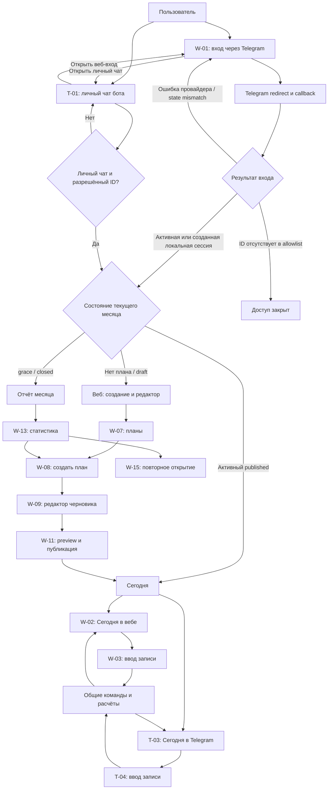
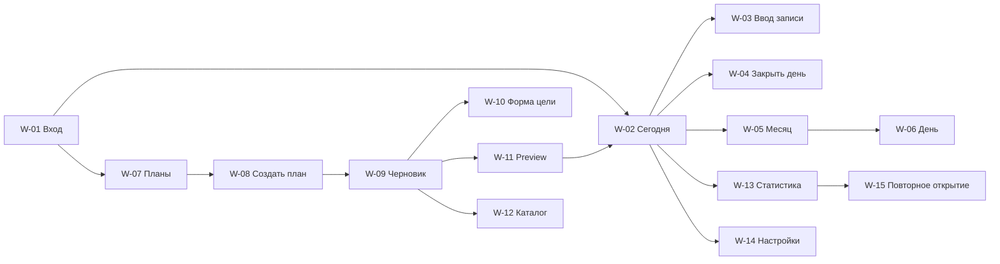
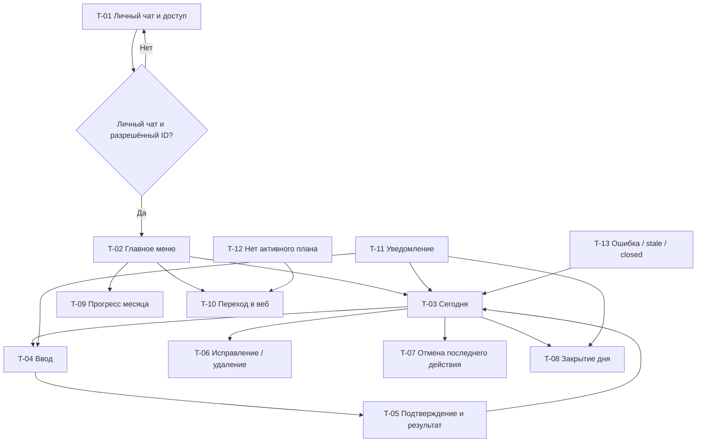

# Screen map: «План на месяц» — пилот

**Версия:** 1.1  
**Дата:** 11 августа 2026 года  
**Статус:** карта экранов пилотной версии  
**Источники:** `PRD.md`, `USER_FLOWS.md`

## 1. Назначение

Документ связывает требования и user flows с будущими wireframes. Он определяет необходимые пользовательские поверхности, переходы, действия и состояния, но не фиксирует визуальный стиль, сетку или библиотеку компонентов.

Backend requirements для недостающих HTTP/read-model зависимостей web surfaces
зафиксированы в `FRONTEND_API_ADDENDUM.md`. До выполнения `F01…F10` наличие
`W-01…W-15` в карте не является утверждением, что все действия уже доступны в
текущем OpenAPI или что отдельный frontend consumer синхронизирован.

Карта следует трём правилам:

1. веб и Telegram показывают одну бизнес-логику и одни подтверждённые данные;
2. настройка и публикация плана в пилоте выполняются в вебе;
3. Telegram в пилоте работает только в личном чате и отвечает за вход через Telegram, «Сегодня», быстрый ввод, исправление, прогресс и уведомления.

## 2. Границы

В карту входят:

- закрытый вход через Telegram OIDC и локальную веб-сессию;
- все веб-экраны пилота;
- Telegram-поверхности пилота;
- общие состояния плана, записи, доступа и операции;
- переходы между каналами;
- трассировка к `UF-01…UF-08`.

Не входят:

- визуальный дизайн и финальная адаптивная компоновка;
- полный редактор плана и каталог в Telegram;
- Telegram-мастера с Back, Cancel и Resume;
- расширенная аналитика, серии, прогноз и корреляции;
- ИИ-ввод свободным текстом;
- публичная регистрация и несколько пространств.

Проверка восстановления из резервной копии остаётся обязательным prelaunch gate технического дизайна, но не создаёт отдельный пользовательский экран.

## 3. Идентификаторы и типы поверхностей

- `W-xx` — веб-страница или вторичная веб-поверхность;
- `T-xx` — сообщение, меню или шаг ввода Telegram;
- `S-xx` — общее состояние, которое одинаково трактуется в обоих каналах.

Главные веб-разделы соответствуют PRD: «Сегодня», «Месяц», каталог, черновик, публикация, статистика и настройки. Экран создания плана, форма цели и подтверждения выделены отдельно, потому что имеют собственные переходы и ошибки.

## 4. Общая карта каналов

## 5. Веб: карта навигации

Расположение пунктов навигации определяется на этапе wireframes. Карта фиксирует доступные назначения, а не конкретный вид меню.

## 6. Веб-поверхности

### W-01. Вход через Telegram

**Назначение:** выполнить закрытый вход через Telegram OIDC по стабильной Telegram identity и получить локальную веб-сессию.

**Основные элементы:**

- основное действие «Продолжить через Telegram»;
- пояснение о переходе в Telegram и возврате в веб после подтверждения;
- указание, что аккаунт определяется по стабильному Telegram ID, а не по изменяемому username;
- состояние перехода и обработки callback без возможности повторно запустить вход до результата;
- безопасное повторение входа после ошибки провайдера или несовпадения состояния;
- переход в личный чат бота `T-01`;
- понятное состояние созданной локальной веб-сессии.

**Состояния:**

- локальная веб-сессия уже активна — повторная авторизация не требуется;
- вход ещё не начат;
- redirect в Telegram выполняется;
- callback обрабатывается;
- пользователь отменил вход или Telegram временно недоступен;
- callback отклонён из-за несовпадения состояния — вход нужно начать заново;
- стабильный Telegram ID отсутствует в закрытом allowlist — доступ не предоставлен;
- локальная веб-сессия создана.

**Переходы:** после успеха — `W-02`, если есть активный план; `W-07`, если план нужно создать или опубликовать; `W-13`, если открыт завершённый месяц.

**Flows:** UF-01.

### W-02. Сегодня

**Назначение:** показать применимые цели текущего дня и дать быстрый доступ к вводу.

**Основные зоны:**

- дата и состояние активного месяца;
- фокус месяца;
- личные цели пользователя;
- shared-цели;
- личные цели партнёра в read-only;
- гибкие цели с фактическим и ожидаемым прогрессом;
- weekly planned tasks текущей недели с `done/not_done`;
- действие «Закрыть день»;
- переходы в месяц и статистику.

**Состояния:**

- активный день с незаполненными ожиданиями;
- часть целей заполнена;
- день явно закрыт;
- все актуальные нормы достигнуты;
- нет применимых ожиданий;
- нет активного опубликованного плана;
- будущий план опубликован, но ещё не активен;
- операция устарела или конфликтует;
- цель партнёра доступна только для просмотра.

**Переходы:** цель → `W-03`; закрытие → `W-04`; календарь → `W-05`; отчёт → `W-13`; отсутствие плана → `W-07`.

**Flows:** UF-04, UF-05, UF-07.

### W-03. Ввод или исправление записи

**Тип поверхности:** вторичная поверхность поверх контекста дня; конкретный паттерн выбирается в wireframes.

**Назначение:** сохранить одно подтверждённое значение или статус.

**Варианты содержимого:**

| Тип цели | Управление | Обязательная обратная связь |
| --- | --- | --- |
| Boolean | `done` или явное `not_done` | Новый статус и автор |
| Quantity `add` | Число и единица | Добавленная порция, сумма и остаток |
| Quantity `latest` | Последнее значение и единица | Заменившее значение и прогресс |
| Actual time | Дата ожидания и локальное время | Попадание в диапазон и целевая дата |
| Rating | Шкала конкретного checkpoint | Сохранённая оценка без оценки «успех/провал» |
| Text | Непустой текст и `done/not_done` | Текст, результат и coverage |
| Checklist | Обязательные подпункты | Частичный прогресс и coverage |
| Варианты «или» | Значения по вариантам | Максимальная доля одного варианта |
| Informational quantity | Значение без target | Факт и график без score |
| Weekly planned task | `done/not_done` на уровне календарной недели | Результат недели и автор |

**Состояния:** новый ввод; частичный прогресс; подтверждённое значение; редактирование; validation error; stale conflict; read-only; `not_applicable`; `closed`.

**Особые действия:** исправление личной записи доступно владельцу; исправление shared-записи требует причины; повтор сохранения не создаёт второй вклад.

**Переходы:** сохранить или отменить → `W-02` либо `W-06`, в зависимости от точки входа.

**Flows:** UF-05.

### W-04. Подтверждение закрытия дня

**Назначение:** показать последствия и одной операцией закрыть только незаполненные фиксированные ожидания.

**Основные элементы:**

- список ожиданий, которые станут `not_done`;
- выбранная текущая или прошедшая дата и граница доступного correction window;
- пояснение, что гибкие цели не получают дневной провал;
- пояснение, что `weekly_planned_task` закрывается на уровне недели и не входит в эту операцию;
- подтверждение и отмена.

**Состояния:** есть незаполненные пункты; нечего закрывать; день уже закрыт; состояние изменилось после открытия подтверждения; дата будущая, pre-activation или уже вне correction window.

**Переходы:** подтвердить или отменить → `W-02`.

**Flows:** UF-07.

### W-05. Месяц

**Назначение:** показать календарь выбранного месяца и состояние каждой даты.

**Основные элементы:**

- переключение доступных месяцев;
- статус плана `draft/published/grace/closed`;
- heatmap или календарные маркеры;
- легенда `done/not_done/no_data/not_applicable`;
- переход к деталям даты.

**Состояния даты:** будущая; активная; заполненная; частично заполненная; явно закрытая; `no_data`; `not_applicable` из-за поздней публикации.

**Состояния месяца:** нет плана; draft; будущий published; активный published; grace; closed; повторно открыт.

**Переходы:** дата → `W-06`; план → `W-07`; отчёт → `W-13`.

**Flows:** UF-02, UF-04, UF-05, UF-08.

### W-06. Детали дня

**Назначение:** просмотреть и при допустимом состоянии исправить записи выбранной даты.

**Основные элементы:** дата, фиксированные ожидания, записи, авторы, shared-состояния и аудит исправлений.

**Состояния:** редактируемый published; редактируемый grace; read-only closed; `not_applicable`; будущая дата.

**Переходы:** редактируемая запись → `W-03`; назад → `W-05`.

**Flows:** UF-05, UF-08.

### W-07. Планы и состояние месяца

**Назначение:** дать точку входа для создания, продолжения черновика, просмотра опубликованного плана и переноса следующего месяца.

**Основные элементы:**

- текущий и следующий месяц;
- статус каждого плана;
- действие создания или копирования;
- продолжение существующего draft;
- просмотр опубликованной конфигурации;
- допустимый возврат будущего published в draft.

**Состояния:** план отсутствует; draft; future published; active published; grace; closed; revised.

**Переходы:** создать → `W-08`; редактировать draft → `W-09`; просмотр active → `W-02`; отчёт → `W-13`.

**Flows:** UF-02, UF-04, UF-08.

### W-08. Создание плана

**Назначение:** выбрать месяц и источник нового черновика.

**Основные элементы:**

- целевой календарный месяц;
- стартовый шаблон, если он ещё не использован;
- выбор своей persona `Участник А|Участник Б` только для стартового шаблона;
- пустой план;
- копирование выбранного прошлого месяца;
- обязательный фокус месяца;
- preview того, что переносится и не переносится.

**Состояния:** первый месяц и persona ещё не выбрана; шаблон уже использован;
есть подходящий прошлый месяц; черновик или published уже существует.

**Переходы:** создать → `W-09`; отменить → `W-07`.

**Flows:** UF-02.

### W-09. Редактор черновика

**Назначение:** собрать и упорядочить конфигурацию месяца до публикации.

**Основные элементы:**

- фокус месяца;
- список целей с владельцем, типом, повторением и нормой;
- перестановка целей;
- добавление из каталога;
- создание или копирование цели;
- удаление цели только из текущего черновика;
- список блокирующих ошибок;
- переход к preview.

**Состояния:** пустой draft; draft с ошибками; draft без блокеров; несохранённые изменения; сохранение подтверждено; stale conflict; read-only после публикации.

**Переходы:** цель → `W-10`; каталог → `W-12`; preview → `W-11`; назад → `W-07`.

**Flows:** UF-02, UF-03.

### W-10. Форма цели

**Тип поверхности:** отдельная форма или вторичная поверхность; визуальный паттерн определяется в wireframes.

**Назначение:** создать или изменить конфигурацию цели в draft.

**Общие поля:** название, `why`, категория, владелец, тип, повторение, порядок.

**Условные секции:**

- target, единица, точность и `add/latest` для количества;
- `targeted/informational`;
- диапазон фактического времени;
- шкала rating;
- checkpoints и `independent/all`;
- checklist;
- варианты «или» с единицами и порогами;
- точное `N`, дни недели или целевая дата.

**Состояния:** новая цель; копия; валидная конфигурация; незаполненные обязательные поля; не задано точное `N`; у `targeted`-количества отсутствует target; изменение, сохраняющее линию; изменение, создающее новую линию.

**Переходы:** сохранить или отменить → `W-09`.

**Flows:** UF-03.

### W-11. Preview и публикация

**Назначение:** показать итоговую конфигурацию и не допустить публикацию неоднозначного плана.

**Основные элементы:**

- месяц и фокус;
- цели, владельцы, нормы и расписания;
- рассчитанные targets неполных периодов;
- display-only provenance исходного значения и принятого resolution, если оно есть;
- блокирующие ошибки конфигурации с переходом к форме;
- последствия поздней публикации;
- revision/schema/hash-version/hash marker, который обновляется при любой
  правке draft, catalog metadata/formula/calendar или смене local activation
  date;
- явное подтверждение.

**Состояния:** blockers present в `200` preview; готово к публикации; scheduled
next month; immediate/late current month; blocked прошедший или дальний month;
stale revision/schema/hash version/hash с действием reload; подтверждение;
published immutable snapshot; exact duplicate replay; already published другой
командой с действием открыть existing publication.

**Переходы:** исправить → `W-09` или `W-10`; подтвердить → `W-02` для активного месяца либо `W-07` для будущего; отменить → `W-09`.

**Flows:** UF-03, UF-04.

### W-12. Каталог целей

**Назначение:** управлять переиспользуемыми определениями без удаления истории.

**Основные элементы:** активные и архивные цели; создание; копирование; архивирование; восстановление; добавление выбранной цели в draft.

**Состояния:** active; archived; используется в draft; существует только в прошлых снимках.

**Правило:** архивирование не изменяет опубликованные и закрытые месяцы.

**Переходы:** создать или изменить будущую конфигурацию → `W-10`; добавить в draft → `W-09`.

**Flows:** UF-03.

### W-13. Статистика месяца

**Назначение:** показать воспроизводимый пилотный отчёт.

**Основные зоны:**

- отдельные вкладки или секции «Участник Б», «Участник А», «Совместные»;
- `monthScore`, coverage и `факт / цель`;
- `goalScore` и `progressPercent` каждой цели;
- heatmap состояний;
- накопительные графики количества;
- тренды фактического времени и rating;
- статус отчёта: текущий, предварительный, закрытый или пересмотренный.

**Состояния:** loading; service error с повтором; active month; preliminary grace; reopened preliminary grace; closed; revised after re-close; нет оцениваемых целей (`N/A`); нет данных для отдельного графика; informational-only metric; перевыполнение.

**Переходы:** день → `W-06`; повторное открытие closed → `W-15`; повторно закрыть reopened month → подтверждение внутри `W-13`; следующий план → `W-08`.

**Flows:** UF-08.

### W-14. Настройки

**Назначение:** управлять личными уведомлениями и состоянием Telegram-доступа.

**Основные элементы:**

- личные утреннее, дневное и вечернее время;
- отключение каждого слота;
- неизменяемое отображение timezone `Asia/Yekaterinburg`;
- стабильная Telegram identity аккаунта без использования username как идентификатора;
- состояние личного чата бота: доступен, blocked или connection lost;
- повторный веб-вход через `W-01` и переход в личный чат через `T-01`;
- данные закрытого пространства без публичного приглашения.

**Состояния:** сохранено; validation error времени; Telegram недоступен; настройки партнёра read-only или не отображаются как редактируемые.

**Переходы:** повторно войти → `W-01`; открыть личный чат → `T-01`; назад → предыдущий основной экран.

**Flows:** UF-01, UF-07.

### W-15. Подтверждение повторного открытия

**Тип поверхности:** подтверждение из закрытого отчёта.

**Назначение:** разрешить исправления закрытого месяца только после явной причины.

**Основные элементы:** обязательная причина; предупреждение о сохранении аудита; пояснение, что конфигурация и уведомления не разблокируются; подтверждение и отмена.

**Состояния:** причина отсутствует; готово к подтверждению; месяц повторно открыт; операция устарела.

**Переходы:** подтвердить → `W-13` в состоянии reopened preliminary grace; отменить → `W-13`. После отдельного повторного закрытия `W-13` показывает состояние revised after re-close.

**Flows:** UF-08.

## 7. Telegram: карта переходов

## 8. Telegram-поверхности

### T-01. Личный чат и доступ к аккаунту

**Назначение:** распознать стабильную Telegram identity в личном чате, предоставить разрешённому участнику функции бота и дать вход в веб через Telegram OIDC.

**Содержимое:** приветствие; предупреждение о работе только в личном чате; статус доступа для стабильного Telegram ID без опоры на username; действие перехода в веб-вход; пояснение, что браузер продолжит активную локальную сессию либо выполнит redirect и callback через Telegram.

**Состояния:** разрешённый Telegram ID; ID отсутствует в закрытом allowlist; обращение не из личного чата; функции бота доступны; переход в веб-вход предложен.

**Flows:** UF-01.

### T-02. Главное меню

**Назначение:** дать стабильные точки входа «Сегодня», «Месяц», «План», «Статистика», «Настройки».

**Пилотное поведение:**

- «Сегодня» → `T-03`;
- «Месяц» → `T-09`;
- «План» → `T-10`, потому что редактор доступен в вебе;
- «Статистика» → текущий прогресс `T-09` и переход к полному отчёту в вебе;
- «Настройки» → `T-10`, потому что настройка времён в пилоте выполняется в вебе.

**Состояния:** активный план; нет активного плана; связь потеряна.

**Flows:** UF-01, UF-06.

### T-03. Сегодня

**Назначение:** показать актуальные личные и shared-действия пользователя.

**Содержимое:** дата; фокус месяца при входе из утреннего уведомления; личные цели; shared-цели; фактический/ожидаемый прогресс гибких целей; weekly planned tasks текущей недели; действие закрытия дня.

**Состояния:** есть актуальные действия; часть заполнена; всё выполнено; день закрыт; shared-норма частично выполнена; нет активного плана.

**Правило доступа:** личные цели партнёра не предлагаются для ввода.

**Переходы:** цель → `T-04`; исправление → `T-06`; undo → `T-07`; закрытие → `T-08`; нет плана → `T-12`.

**Flows:** UF-06, UF-07.

### T-04. Ввод значения

**Назначение:** запросить только значение, ожидаемое выбранным типом цели.

**Варианты:** кнопка boolean; число и единица; фактическое время с датой ожидания; rating checkpoint; непустой текст и результат; подпункт checklist; вариант «или»; week-level `done/not_done` для weekly planned task.

**Состояния:** ожидание значения; validation error; stale goal state; цель уже закрыта; пользователь отменил ввод.

**Правило:** свободная фраза вне ожидаемого шага не разбирается как ИИ-команда.

**Переходы:** корректное значение → `T-05`; отмена → `T-03`; stale/closed → `T-13`.

**Flows:** UF-06.

### T-05. Подтверждение и результат

**Назначение:** показать, что именно будет или было сохранено.

**Содержимое:** цель, дата, значение, единица, способ агрегации при необходимости, новый прогресс.

**Состояния:** требуется подтверждение; сохранено; duplicate callback вернул прежний результат; сохранение отклонено из-за конфликта.

**Переходы:** подтвердить → обновлённый `T-03`; исправить ввод → `T-04`; конфликт → `T-13`.

**Flows:** UF-06.

### T-06. Исправление или удаление записи

**Назначение:** изменить допустимую личную или shared-запись.

**Состояния и правила:**

- собственная личная запись — доступно исправление или удаление;
- личная запись партнёра — действие недоступно;
- shared-запись — исправление доступно любому участнику после ввода причины;
- closed month — изменение блокируется.

**Переходы:** сохранить → `T-03`; отменить → `T-03`; closed/stale → `T-13`.

**Flows:** UF-06.

### T-07. Отмена последнего действия

**Назначение:** отменить только последнее собственное действие пользователя.

**Состояния:** действие доступно; отменять нечего; последняя запись уже изменена; операция устарела.

**Правило:** действие партнёра этой командой не отменяется.

**Переходы:** результат → `T-03`.

**Flows:** UF-06.

### T-08. Закрытие дня

**Назначение:** показать будущие `not_done` и запросить подтверждение.

**Содержимое:** выбранная текущая или прошедшая дата, список незаполненных personal/shared фиксированных ожиданий, пояснение о гибких целях; Confirm/Cancel.

**Состояния:** есть пункты; нечего закрывать; день уже закрыт; состояние изменилось до callback; дата недоступна или correction window истекло.

**Правило:** гибкие квоты и `weekly_planned_task` не переводятся в дневной `not_done`; забытая дата после correction deadline остаётся `no_data`.

**Переходы:** подтвердить или отменить → `T-03`; stale → `T-13`.

**Flows:** UF-07.

### T-09. Прогресс месяца

**Назначение:** показать краткий текущий прогресс пилота без расширенной аналитики.

**Содержимое:** личный прогресс пользователя; shared-прогресс; актуальные `факт / цель`; ссылка на полный веб-отчёт.

**Состояния:** plan absent; draft с переходом в веб; future published с датой активации; active published; grace; closed; reopened grace; service error.

**Flows:** UF-06, UF-08.

### T-10. Переход в веб

**Назначение:** честно направить пользователя к функции, которая в пилоте доступна только в вебе.

**Варианты сообщения:** создать/отредактировать план; настроить уведомления; открыть полный отчёт; опубликовать draft.

**Правило:** бот не имитирует неполный Telegram-редактор и не запускает мастер завершённой v1.

**Flows:** UF-02, UF-03, UF-04, UF-07, UF-08.

### T-11. Уведомление

**Назначение:** доставить только актуальные действия конкретного слота.

**Варианты:**

- утро — фокус, фиксированные ожидания и гибкие цели ниже темпа;
- день — наступившие checkpoints, срочные фиксированные пункты и гибкие цели ниже темпа;
- вечер — оставшиеся фиксированные пункты, гибкие цели ниже темпа и «Закрыть день».

**Shared relevance:** общий progress ниже темпа показывается одинаково обоим
участникам; достигнутая общая норма скрывается у обоих.

**Состояния:** сообщение отправлено не более одного раза на слот; актуальных пунктов нет — сообщение отсутствует; слот просрочен — сообщение не догоняет пользователя; бот заблокирован.

**Переходы:** цель → `T-04`; «Сегодня» → `T-03`; закрытие → `T-08`.

**Flows:** UF-07.

### T-12. Нет активного плана

**Назначение:** объяснить отсутствие ежедневных действий и направить в веб.

**Варианты:** нет draft; draft не опубликован; future published ещё не активен; месяц завершён.

**Переходы:** действие → `T-10`.

**Flows:** UF-02, UF-04, UF-06.

### T-13. Ошибка или устаревшее состояние

**Назначение:** безопасно восстановить сценарий без дублирования или потери подтверждённой записи.

**Варианты:** duplicate callback; stale button; конфликт версии; цель закрыта; месяц стал `closed`; связь потеряна; некорректное значение.

**Действия:** показать актуальное состояние; предложить повторить текущий выбор; вернуться в `T-03`; при проблеме доступа перейти к `T-01`, а для новой локальной веб-сессии — к `W-01`.

**Flows:** UF-01, UF-06, UF-07.

## 9. Общие состояния

### S-01. Жизненный цикл плана

| Состояние | Веб | Telegram |
| --- | --- | --- |
| Нет плана | `W-07/W-08` | `T-12/T-10` |
| `draft` | `W-09`; записи недоступны | Переход к вебу |
| Future `published` | Read-only конфигурация; ожидание активации | Сообщение о дате старта |
| Active `published` | Ввод и исправление записей | «Сегодня», ввод и уведомления |
| `grace` | Исправления и preliminary report | Ввод только допустимых исправлений; отчёт в вебе |
| `closed` | Read-only report; возможно повторное открытие | Записи заблокированы; отчёт в вебе |
| Reopened `grace` | Исправления записей, locked configuration | Старые уведомления не возобновляются |

### S-02. Доступ к записи

| Вид цели | Просмотр | Создание и исправление |
| --- | --- | --- |
| Собственная личная | Оба участника | Только владелец |
| Личная партнёра | Оба участника | Недоступно |
| Shared | Оба участника | Любой участник; исправление с причиной |

### S-03. Состояние значения

| Состояние | Отображение | Напоминание |
| --- | --- | --- |
| `no_data` | Ожидание пустое | Да, если наступил срок |
| `done` | Выполнено | Нет |
| `not_done` | Явно не выполнено | Нет для этого фиксированного ожидания |
| `not_applicable` | Системно исключено | Нет |
| Partial quantity | Факт, процент и остаток | Да до target |
| Completed flexible target | Норма достигнута | Нет до следующего периода |
| Informational | Факт без score | Нет |

### S-04. Состояние операции

- **Current:** действие применяется и возвращает подтверждённое состояние.
- **Duplicate:** возвращается прежний результат без второго вклада.
- **Stale:** показывается актуальное состояние, пользователь повторяет выбор.
- **Conflict:** уже подтверждённая запись не перезаписывается.
- **Blocked:** действие запрещено правами, состоянием месяца или `not_applicable`.

После успешной операции канал автора показывает подтверждённое состояние. Другой открытый канал получает его при следующем обновлении или повторном открытии; карта не обещает realtime-синхронизацию.

### S-05. Общие состояния интерфейса

- **Loading:** данные ещё загружаются, повторная команда недоступна до результата.
- **Empty:** данных действительно нет; показывается соответствующее действие, если оно существует.
- **Validation error:** ошибка привязана к конкретному вводу, уже подтверждённые данные не меняются.
- **Service error:** пользователь может безопасно повторить загрузку или действие; неизвестный результат не показывается как успех.
- **Read-only:** причина блокировки видима — права, будущая дата, published configuration или closed month.
- **Success:** отображается только подтверждённое системой состояние.

### S-06. Системные состояния уведомлений

- Нет активного published-плана — ежедневные уведомления полностью отключены.
- Slot already sent — второй экземпляр этого слота не создаётся.
- Nothing relevant — сообщение не создаётся, включая случай, когда остался только фокус месяца.
- Expired — просроченный слот отбрасывается и не доставляется пачкой после восстановления.
- Telegram unavailable — отправка не блокирует веб-ввод; предупреждение показывается в `W-14`.
- Shared target completed — shared-цель подавляется у обоих только после достижения общей нормы.

## 10. Трассировка user flows к поверхностям

| User flow | Веб | Telegram | Общие состояния |
| --- | --- | --- | --- |
| UF-01 | W-01 redirect/callback/local session, W-14 | T-01 private chat/allowlist, T-02 | S-05 |
| UF-02 | W-07, W-08, W-09 | T-10, T-12 | S-01, S-05 |
| UF-03 | W-09, W-10, W-11, W-12 | T-10 | S-01, S-04, S-05 |
| UF-04 | W-07, W-09, W-11, W-02 | T-10, T-12 | S-01, S-04, S-05 |
| UF-05 | W-02, W-03, W-05, W-06 | — | S-02, S-03, S-04, S-05 |
| UF-06 | W-02 как общее состояние | T-02–T-07, T-09, T-13 | S-02, S-03, S-04, S-05 |
| UF-07 | W-02, W-04, W-14 | T-03, T-08, T-11, T-13 | S-03–S-06 |
| UF-08 | W-05, W-06, W-07, W-13, W-15 | T-09, T-10, T-12 | S-01, S-03–S-05 |

## 11. Набор экранов для первого прототипа

### Обязательные web frames

1. `W-01` — начало Telegram OIDC, redirect/callback loading, ошибка провайдера, несовпадение состояния, отказ закрытого allowlist и успешная локальная сессия.
2. `W-02` — активный день с mixed personal/shared/flexible целями.
3. `W-03` — quantity `add`, actual time, rating checkpoint и shared correction.
4. `W-04` — preview закрытия дня.
5. `W-05` — месяц с четырьмя состояниями записей.
6. `W-07/W-08` — отсутствие плана и выбор источника черновика.
7. `W-09/W-10` — draft с гибкой целью без exact `N`, `targeted`-количеством без target и форма исправления.
8. `W-11` — blockers present и ready to publish.
9. `W-13` — preliminary и closed report.
10. `W-14` — три времени уведомлений и состояние Telegram.
11. `W-15` — обязательная причина повторного открытия.

### Обязательные Telegram frames

1. `T-01` — разрешённый участник в личном чате, неизвестный allowlist ID и переход в веб-вход.
2. `T-03` — актуальный список «Сегодня».
3. `T-04/T-05` — ввод количества и подтверждённый результат.
4. `T-06` — shared correction с причиной.
5. `T-08` — preview закрытия дня.
6. `T-11` — утреннее и вечернее уведомления.
7. `T-12` — нет активного плана с переходом в веб.
8. `T-13` — duplicate/stale callback.

## 12. Критерии готовности карты

Карта готова к wireframes, если:

1. каждый `UF-01…UF-08` связан хотя бы с одной пользовательской поверхностью;
2. семь обязательных веб-разделов PRD представлены;
3. все типы ежедневного ввода имеют соответствующую поверхность;
4. `draft/published/grace/closed` и повторно открытый месяц имеют видимые состояния;
5. `done/not_done/no_data/not_applicable`, partial и informational различаются;
6. личные, partner read-only и shared-права различаются;
7. duplicate, stale, conflict и blocked не приводят к скрытому повторному сохранению;
8. Telegram pilot не содержит редактора плана, мастеров или ИИ;
9. advanced analytics не попадает в пилотный отчёт;
10. карта не принимает решения о конкретных нормах вместо пользователя.
