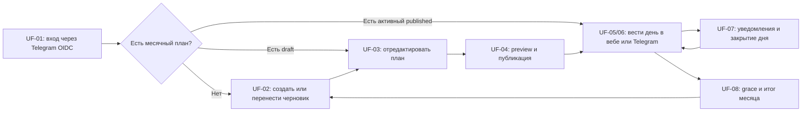

# User flows: «План на месяц» — пилот

**Версия:** 1.1  
**Дата:** 11 августа 2026 года  
**Статус:** сценарии пилотной версии  
**Источник требований:** `PRD.md`

## 1. Назначение

Документ описывает, как Участник А и Участник Б проходят пилот «Плана на месяц» от первого входа до закрытия месяца и переноса следующего плана. Он используется как общий источник для UX-проектирования, разработки и приёмки.

User flows не назначают значения произвольного будущего месячного плана: нормы, владельцев и другие параметры человек меняет в черновике. Одноразовый стартовый шаблон является отдельным полностью заполненным набором данных: спорные места исходного документа в нём уже разрешены и не требуют повторного выбора перед первой публикацией.

## 2. Границы пилота

В документ входят:

- закрытое пространство Участник А и Участник Б;
- вход в веб через Telegram OIDC Authorization Code flow с PKCE;
- создание, перенос, редактирование и публикация месяца в вебе;
- ежедневный ввод в вебе и Telegram;
- персональные уведомления и закрытие дня;
- grace period, закрытие месяца и пилотный отчёт.

Не входят:

- каталог и редактор плана в Telegram;
- сохраняемые Telegram-мастера редактирования черновика;
- серии, прогноз, сравнение месяцев и корреляционные наблюдения;
- свободный ИИ-ввод;
- публичная регистрация и дополнительные пространства.

## 3. Участники, каналы и состояния

### Участники

- **Участник А** и **Участник Б** — равноправно управляют каталогом, черновиком, публикацией и настройками пространства.
- Владелец личной цели вносит и исправляет её записи.
- Любой участник может внести или исправить совместную запись; причина исправления обязательна.
- Система хранит автора исходного действия и последующих изменений.

### Каналы

- **Веб** — полный редактор плана, «Сегодня», календарь, настройки и отчёт.
- **Telegram** — OIDC-подтверждение личности для входа в веб, а в личном чате бота — «Сегодня», ввод и исправление записей, текущий прогресс и уведомления.
- Оба канала применяют одинаковые продуктовые команды и правила расчёта.

### Состояния месяца

- `draft` — конфигурация изменяется;
- `published` — конфигурация зафиксирована, записи доступны после активации;
- `grace` — записи исправляются, отчёт предварительный;
- `closed` — записи заблокированы, отчёт зафиксирован.

### Состояния ожидания

- `done` — выполнено;
- `not_done` — явно не выполнено;
- `no_data` — применимая запись отсутствует;
- `not_applicable` — запись системно не требовалась.

## 4. Обзор пути

## 5. Формат сценария

Каждый flow содержит:

- цель и участников;
- предусловия и триггер;
- основной путь;
- альтернативы, ошибки и восстановление;
- конечное состояние;
- ссылки на разделы и acceptance scenarios PRD.

## UF-01. Первый вход через Telegram OIDC

### Цель

Разрешить одному из двух известных участников безопасно войти в веб через принадлежащий ему Telegram-аккаунт без отдельного пароля или передачи номера телефона Planner.

### Участники и каналы

- Участник А или Участник Б;
- веб и экран авторизации Telegram.

### Предусловия

- Закрытое пространство пары создано.
- Неизменяемые Telegram user ID обоих участников заранее внесены в закрытый allowlist пространства.
- Для веба настроен допустимый Telegram OIDC redirect URI.

### Триггер

Пользователь открывает веб без действующей сессии.

### Основной путь

1. Веб предлагает войти через Telegram.
2. Пользователь начинает вход и перенаправляется на экран авторизации Telegram.
3. Пользователь подтверждает вход на стороне Telegram. Planner не запрашивает и не сохраняет его номер телефона.
4. Telegram возвращает браузер на разрешённый callback Planner с результатом авторизации.
5. Система проверяет callback, `state`, `nonce`, PKCE, подпись и claims и получает verified `issuer`, `subject` и numeric Telegram user ID.
6. Система находит numeric Telegram user ID в закрытом allowlist и связывает `(issuer, subject)` и этот ID с одним соответствующим pre-provisioned участником.
7. Система создаёт локальную веб-сессию именно этого участника.
8. Пользователь попадает на актуальный экран: «Сегодня» при активном плане либо действие создания/публикации плана при его отсутствии.

### Альтернативы и ошибки

- **Telegram user ID отсутствует в allowlist:** локальный аккаунт и сессия не создаются, данные пространства не открываются.
- **Пользователь отменил вход на стороне Telegram:** веб возвращает его на экран входа без созданной сессии.
- **Ошибка или повтор callback:** недействительный, просроченный или уже обработанный результат отклоняется; пользователь может начать новый вход.
- **Проверка `state`, `nonce` или PKCE не прошла:** сессия не создаётся, вход начинается заново.
- **Telegram временно недоступен или не удалось проверить ответ провайдера:** веб показывает временную ошибку и предлагает повторить вход позже.
- **Redirect URI не принят провайдером:** вход завершается ошибкой без создания сессии; пользователь остаётся на экране входа.
- **Номер телефона не передан:** это не препятствует входу, потому что Planner его не использует.
- **Username изменился:** доступ сохраняется, потому что идентификатором остаётся Telegram user ID.

### Результат

- Локальная веб-сессия связана ровно с одним участником из allowlist.
- Действия пользователя дальше сохраняются с его авторством.
- Права определяются локальным участником и владельцем цели, а не Telegram username или номером телефона.

### Трассировка

- PRD: §§5.1–5.4, 14.1, 18.
- Acceptance: AC-01, AC-01b; критерий пилота 1.

## UF-02. Создание или перенос месячного плана

### Цель

Создать редактируемый черновик для выбранного календарного месяца без случайного переноса старых записей.

### Участники и канал

- Участник А или Участник Б;
- веб.

### Предусловия

- Пользователь вошёл в закрытое пространство.
- Для целевого месяца ещё нет опубликованного плана.

### Триггер

Пользователь выбирает «Создать план» или «Следующий месяц».

### Основной путь

1. Пользователь выбирает целевой календарный месяц.
2. Система предлагает один из доступных источников:
   - одноразовый стартовый шаблон — для первого месяца;
   - пустой черновик;
   - копию выбранного прошлого месяца.
3. При выборе стартового шаблона пользователь указывает свою persona в исходном
   документе — Участник А или Участник Б. Система связывает второго участника с оставшейся
   persona; это не меняет равные права участников и не зависит от membership slot.
4. При выборе стартового шаблона система загружает уже разрешённую конфигурацию:
   - фокус месяца — «Показатель 108»;
   - медитации — `16` за месяц;
   - фитнес Участник Б — `2` раза в неделю;
   - совместная активность — `2` раза в неделю;
   - публикации выполняются во всех перечисленных каналах;
   - количество коллабораций — целевая месячная метрика с target `7`;
   - «важная задача дня» — совместная цель;
   - пять weekly outreach-задач принадлежат Участник Б;
   - нормы и знаменатели периодов рассчитываются по календарю продукта, а бумажные итоговые знаменатели не переопределяют расчёт.
5. При копировании система переносит конфигурации снимков, ссылки на линии целей и порядок отображения.
6. Система не переносит записи, статусы, заметки, результаты, coverage или рассчитанный прогресс.
7. Пользователь проверяет и при необходимости изменяет обязательный фокус месяца.
8. Система создаёт план в состоянии `draft` и открывает редактор.
9. Исходный прошлый месяц и его отчёт остаются неизменными.

### Альтернативы и ошибки

- **Для месяца уже есть опубликованный план:** система не создаёт второй и открывает существующий.
- **Для месяца уже есть черновик:** система предлагает продолжить его, а не создавать дубликат.
- **Архивная цель присутствовала в прошлом снимке:** она переносится как часть выбранного снимка, но её каталожное состояние не изменяется молча.
- **Стартовый шаблон уже использован:** вариант одноразового шаблона больше не предлагается; остаются пустой план и копирование.
- **Повтор отправки того же выбора:** возвращается первоначальный draft; другая
  команда после consumption не создаёт новый месяц.

### Результат

- Существует один черновик выбранного месяца.
- В черновике нет фактов прошлого месяца.
- Стартовый шаблон не содержит нерешённых расхождений исходного документа.
- Конфигурация готова к редактированию в UF-03.

### Трассировка

- PRD: §§7.2, 8, 19.
- Acceptance: AC-02, AC-23; критерий пилота 7.

## UF-03. Редактирование и валидация плана

### Цель

Подготовить полный и однозначный черновик, который можно безопасно опубликовать.

### Участники и канал

- Участник А или Участник Б;
- веб.

### Предусловия

- План находится в `draft`.
- Пользователь вошёл в пространство.

### Триггер

Пользователь открывает редактор черновика.

### Основной путь

1. Система показывает фокус месяца, порядок целей и видимые ошибки конфигурации.
2. Пользователь может:
   - добавить существующую цель из каталога;
   - создать или скопировать каталожную цель;
   - убрать цель из черновика без удаления истории;
   - изменить порядок отображения;
   - архивировать или восстановить каталожную цель для будущих черновиков.
3. Для каждой цели пользователь задаёт владельца, тип, повторение, норму, единицу, точность и агрегацию, если они применимы.
4. Пользователь настраивает checkpoints, checklist или варианты «или», если этого требует смысл цели.
5. Для количества без нормы пользователь явно выбирает `targeted` с target либо `informational` без score и напоминаний.
6. Если пользователь создаёт новую неполную или противоречивую конфигурацию, система показывает конкретную ошибку. Например:
   - для новой личной цели не выбран владелец;
   - у гибкой цели отсутствует точное целое `N`;
   - у `targeted`-количества отсутствует target;
   - у checklist или вариантов «или» не добавлено ни одного пункта;
   - обязательный checkpoint не имеет названия или срока.
7. Исправленное значение сохраняется только в текущем черновике и его будущем снимке.
8. Система пересчитывает список блокирующих ошибок после каждого изменения.
9. Пользователь сохраняет черновик и переходит к preview.

### Альтернативы и ошибки

- **Обязательное поле не заполнено:** цель сохраняется в черновике с ошибкой, но публикация остаётся недоступной.
- **Норма `N` не целая или меньше 1:** система показывает ошибку у поля.
- **Неверная единица, точность или target:** система сохраняет введённые данные только после исправления формата.
- **Цель архивирована после публикации прошлого месяца:** прошлый снимок не изменяется.
- **Два участника изменили один черновик:** устаревшее изменение не перезаписывает подтверждённое; веб показывает актуальное состояние и предлагает повторить правку.
- **Попытка редактировать активный опубликованный месяц:** конфигурация остаётся заблокированной; разрешены только записи выполнения.

### Результат

- Черновик содержит выбранные человеком значения.
- Все реальные ошибки конфигурации видны до публикации.
- Изменения каталога не затрагивают опубликованные и закрытые месяцы.

### Трассировка

- PRD: §§7.3, 8–10, 13, 19–20, приложение A.
- Acceptance: AC-03, AC-22, AC-SM-01.

## UF-04. Preview, публикация и активация

### Цель

Зафиксировать однозначную конфигурацию месяца и активировать её в допустимую дату.

### Участники и канал

- Участник А или Участник Б;
- веб.

### Предусловия

- План находится в `draft`.
- Целевой месяц является текущим или следующим по `Asia/Yekaterinburg`.

### Триггер

Пользователь выбирает «Проверить и опубликовать».

### Основной путь

1. Система одним read-only действием строит revision-bound preview: фокус, ordered goals, владельцы, типы, нормы, расписания, checkpoints, provenance, activation и рассчитанные calendars/targets.
2. Система повторно проверяет обязательные поля и ошибки конфигурации.
3. Preview возвращает deterministic schema/hash versions и hash даже при
   blockers; при их отсутствии пользователь подтверждает именно этот draft
   revision и hash.
4. В одной transaction система заново строит preview из locked draft,
   сравнивает revision/versions/hash и создаёт неизменяемую publication:
   focus, ordered goal snapshots, config/provenance, exact calendars/targets и
   formula versions; затем устанавливает active pointer, переводит plan в
   `published` и фиксирует audit/receipt.
5. Для следующего месяца система ждёт `00:00` первого дня месяца; до этого записи и уведомления недоступны.
6. Для текущего месяца план активируется сразу.
7. При публикации после первого числа система:
   - выводит прошедшие даты как `not_applicable` из publication metadata, не
     создавая физических fixed expectations;
   - исключает их из score и coverage;
   - пропорционально пересчитывает недельные и месячные нормы;
   - не создаёт прошлые уведомления.
8. После активации пользователь переходит на «Сегодня».

### Альтернативы и ошибки

- **Есть блокирующие ошибки:** публикация отклоняется, каждая ошибка ведёт к соответствующему полю UF-03.
- **Preview устарел:** ни одна publication/history/receipt строка не создаётся;
  система возвращает текущие revision/hash versions/hash и действие заново
  открыть preview.
- **План относится к прошедшему месяцу:** публикация запрещена.
- **Пользователь отменяет подтверждение:** план остаётся `draft` без изменения данных.
- **Будущий опубликованный план нужно изменить:** до начала месяца его можно вернуть в `draft`, только если записей нет.
- **Месяц уже начался:** конфигурацию вернуть в `draft` нельзя.
- **Повтор той же команды публикации:** exact receipt replay возвращает ту же
  publication revision без clock, membership/draft read и новых writes.
- **Другая команда после публикации:** второй active snapshot не создаётся;
  система возвращает ID/revision существующей publication и действие открыть
  опубликованный план.

### Результат

- Опубликованная конфигурация зафиксирована.
- Published snapshot можно открыть по publication ID; чужой и отсутствующий ID
  неразличимы. Current active query не возвращает scheduled future, draft,
  grace, closed или absent plan и ничего не активирует записью.
- Записи доступны только в активной части месяца.
- Прошедшие при поздней публикации даты не ухудшают отчёт.

### Трассировка

- PRD: §§7.1, 7.3–7.4, 12.1–12.3, 13.
- Acceptance: AC-03, AC-04, AC-05, AC-22.

## UF-05. Ведение дня в вебе

### Цель

Позволить участнику заполнить применимые цели дня, увидеть подтверждённый прогресс и исправить ошибку до закрытия месяца.

### Участники и канал

- Участник А или Участник Б;
- веб, экран «Сегодня».

### Предусловия

- Есть активный `published` план.
- Текущая дата входит в активную часть месяца.

### Триггер

Пользователь открывает «Сегодня» или возвращается на него после сохранения записи.

### Основной путь

1. Система показывает:
   - личные цели пользователя, доступные для ввода;
   - совместные цели, доступные обоим;
   - личные цели партнёра в режиме просмотра;
   - фактический и ожидаемый прогресс гибких целей.
2. Пользователь выбирает применимое ожидание.
3. Интерфейс ввода соответствует типу:
   - boolean — `done` или явное `not_done`;
   - quantity `add` — новая порция добавляется к сумме;
   - quantity `latest` — новое значение заменяет актуальное;
   - actual time — дата ожидания и локальное время;
   - rating — значение для конкретного checkpoint;
   - text — непустой текст и результат `done/not_done`;
   - checklist — статусы обязательных подпунктов;
   - «или» — значения одного или нескольких вариантов без сложения их долей;
   - informational quantity — факт без target, score и напоминаний.
4. Система валидирует значение и сохраняет его одной продуктовой операцией.
   Для нового Boolean/`latest` logical record revision отсутствует, для
   изменения передаётся текущая positive revision; `add` всегда создаёт новый
   contribution и не принимает revision существующего факта. Actual time и
   rating также создаются без revision и исправляются только с текущей positive
   fact revision; checkpoint адресуется stable checkpoint ID и имеет
   независимую revision chain.
5. Система показывает подтверждённое состояние, автора записи и пересчитанный прогресс.
6. Частичное количество или вариант дают частичный прогресс; перевыполнение сохраняется, но score ограничивается правилами PRD.
7. Для гибкой цели система обновляет `actualProgress`, требуемый темп и необходимость последующих напоминаний.
8. Пользователь при необходимости открывает запись и исправляет её:
   - личную — только владелец;
   - совместную — любой участник с обязательной причиной.
   Исправление всегда передаёт opaque record ID, текущую revision, новое typed
   значение и непустую причину в dedicated correction-команду; повторная
   typed record-команда существующий факт не перезаписывает. Удаление доступно
   только владельцу personal-записи и сохраняется как tombstone с причиной.

### Альтернативы и ошибки

- **Нет активного плана:** экран предлагает создать или опубликовать черновик; ввод недоступен.
- **Ожидание `not_applicable`:** поле не принимает запись и объясняет причину.
- **Пользователь пытается изменить личную цель партнёра:** интерфейс остаётся read-only.
- **Количество отрицательное или нарушает точность:** сохранение отклоняется с ошибкой поля.
- **Пустой text:** запись не сохраняется.
- **Time-range пересекает полночь:** пользователь выбирает дату ожидания; время после `00:00` относится к этой выбранной ночи, а не создаёт запись следующего дня.
- **Устаревшее состояние:** подтверждённая ранее запись сохраняется, пользователь получает актуальное значение и повторяет правку при необходимости.
- **Повтор операции:** итоговое значение не изменяется второй раз, включая `add` и shared-выполнение.
- **План `closed`:** запись отклоняется до повторного открытия месяца.

### Результат

- Сохранён один подтверждённый факт или статус.
- Прогресс, уведомления и будущий отчёт используют обновлённые данные.
- Аудит отражает автора и исправления.

### Трассировка

- PRD: §§5.3–5.4, 9–12, 13, 20.
- Acceptance: AC-06, AC-07, AC-08, AC-13, AC-14, AC-16, AC-17, AC-18, AC-19, AC-20, AC-21.

## UF-06. Ведение дня через Telegram

### Цель

Дать участнику быстрый кнопочный ввод тех же ежедневных фактов без открытия веба.

### Участники и канал

- Участник А или Участник Б;
- личный чат Telegram-бота.

### Предусловия

- Telegram user ID находится в закрытом allowlist и разрешается в локального участника независимо от наличия веб-сессии.
- Есть активный опубликованный план.

### Триггер

Пользователь нажимает «Сегодня», кнопку из уведомления или действие конкретной цели.

### Основной путь

1. Бот показывает актуальные личные и совместные действия пользователя и текущий прогресс.
2. Пользователь выбирает цель.
3. Бот показывает подходящие кнопки или запрашивает одно конкретное значение: число, время, rating, текст или подпункт checklist.
4. Перед сохранением бот показывает выбранную цель, дату и значение, если ввод требует подтверждения.
5. Пользователь подтверждает действие.
6. Система применяет ту же продуктовую команду и валидацию, что и веб.
7. Бот обновляет сообщение либо показывает подтверждённое состояние и новый прогресс.
8. Пользователь может:
   - исправить или удалить собственную личную запись;
   - исправить shared-запись с причиной;
   - отменить последнее ещё не отменённое собственное действие в месяце
     выбранной записи, если запись не была после этого изменена партнёром или
     системой;
   - вернуться к списку «Сегодня».

### Альтернативы и ошибки

- **Повторный callback или повторная доставка Telegram update:** система возвращает прежний результат и не создаёт второй вклад.
- **Устаревшая кнопка:** бот загружает актуальное состояние и предлагает повторить выбор, не перезаписывая новые данные.
- **Цель уже закрыта:** бот показывает достигнутую норму и не предлагает повторное выполнение, если оно не допускается конфигурацией.
- **Shared-цель частично выполнена:** она остаётся у обоих до достижения общей нормы.
- **Нет активного плана:** бот показывает действие перехода к созданию или публикации плана в вебе.
- **План перешёл в `closed` во время ввода:** сохранение отклоняется, бот показывает актуальный статус месяца.
- **Последнее собственное действие относится к другой записи:** отмена не
  перескакивает через него; бот показывает актуальную запись.
- **Запись после собственного действия изменил партнёр или система:** отмена
  отклоняется как устаревшая и не меняет историю.
- **Повторная отмена:** бот идёт назад по собственному стеку, пропуская уже
  компенсированные действия и сами отмены.
- **Групповой чат или неизвестный Telegram user ID:** бот не обрабатывает данные пространства.
- **Свободная фраза вне ожидаемого шага:** бот не пытается разбирать её как ИИ-команду.

### Результат

- Веб и Telegram отражают одну запись при следующем обновлении состояния.
- Повторная доставка не меняет итог.
- Автор и исправления входят в аудит.

### Трассировка

- PRD: §§14.1–14.2, 14.5, 20.
- Acceptance: AC-06, AC-10, AC-17; критерий пилота 5.

## UF-07. Уведомления и закрытие дня

### Цель

Напоминать только об актуальных действиях и позволить явно завершить день без ложного дневного провала гибких целей.

### Участники и каналы

- Участник А и Участник Б независимо друг от друга;
- настройки в вебе, уведомления и действие закрытия в Telegram или вебе.

### Предусловия

- Telegram user ID участника находится в закрытом allowlist и разрешается в его локальный аккаунт независимо от наличия веб-сессии.
- Есть активный опубликованный план.
- Для пользователя настроены и не отключены соответствующие слоты.

### Триггер

- Наступает утреннее, дневное или вечернее время пользователя по `Asia/Yekaterinburg`;
- либо пользователь самостоятельно выбирает «Закрыть день».

### Настройка уведомлений

1. Пользователь открывает настройки в вебе.
2. Пользователь независимо задаёт утреннее, дневное и вечернее время либо отключает отдельные слоты.
3. Система сохраняет времена только для этого участника и интерпретирует их в `Asia/Yekaterinburg`.
4. Настройки партнёра не изменяются.

### Основной путь уведомления

1. Система рассчитывает актуальные ожидания непосредственно перед отправкой.
2. Утром система включает в сообщение:
   - фокус месяца;
   - фиксированные пункты дня;
   - гибкие цели ниже равномерного темпа;
   - текущий прогресс без закрытых норм.
3. Днём система включает checkpoints с наступившим сроком, фиксированные пункты со сроком не позднее слота и гибкие цели ниже темпа.
4. Вечером система включает оставшиеся фиксированные ожидания, гибкие цели ниже темпа и действие «Закрыть день».
5. Выполненное, явно закрытое или корректно измеренное фиксированное ожидание исключается из следующих сообщений; частичное целевое количество остаётся с указанием остатка.
6. Достигнутая недельная, месячная или общая норма исключается до следующего периода.
7. Если после фильтрации актуальных пунктов нет, сообщение не отправляется; один фокус месяца не создаёт отдельное сообщение.

### Основной путь закрытия дня

1. Система показывает все незаполненные фиксированные ожидания и checkpoints текущей даты.
2. Пользователь подтверждает закрытие дня.
3. Система одной операцией переводит показанные ожидания в `not_done`.
4. Уже заполненные и будущие ожидания не меняются.
5. Гибкие недельные и месячные цели не получают дневной `not_done`; их дефицит определяется по завершении периода.
6. `weekly_planned_task` не включается в закрытие дня и закрывается на уровне своей недели.
7. Экран и Telegram показывают завершённое состояние дня.

### Закрытие weekly planned task

1. В течение применимой календарной недели владелец видит weekly planned task в отдельном блоке недели в вебе и Telegram.
2. Владелец может выставить ей `done` или `not_done`; результат сохраняется с автором и доступен для исправления по общим правилам месяца.
3. В `00:00` следующего понедельника либо на границе месяца система одной идемпотентной операцией переводит оставшуюся незаполненной weekly planned task в `not_done` от system actor.
4. Уже сохранённый пользовательский результат автоматическое закрытие не меняет.

### Альтернативы и ошибки

- **Пользователь отменяет preview закрытия:** статусы не меняются.
- **День уже закрыт:** повтор команды возвращает прежний результат и не создаёт новые `not_done`.
- **Пользователь исправляет `not_done`:** до автоматического закрытия месяца исправление разрешено с аудитом.
- **Сервис был недоступен:** просроченный слот не доставляется после наступления следующего слота или дня.
- **После восстановления накопилась очередь:** старые уведомления не отправляются пачкой.
- **Бот заблокирован или больше не может отправлять сообщения:** веб показывает предупреждение; записи остаются доступны в вебе.
- **Один участник закрыл shared-норму:** после достижения общей нормы цель исчезает у обоих.

### Результат

- Пользователь получает не более одного актуального сообщения на слот.
- Фиксированные пропуски дня явно отличаются от `no_data` и `not_applicable`.
- Гибкие цели сохраняют недельную или месячную модель оценки.

### Трассировка

- PRD: §§11, 12.3, 15, 20.
- Acceptance: AC-09, AC-10, AC-24; критерий пилота 6.

## UF-08. Завершение месяца, отчёт и следующий план

### Цель

Зафиксировать воспроизводимый итог месяца, разрешить ограниченные исправления и создать следующий план без старых фактов.

### Участники и каналы

- Участник А и Участник Б;
- веб, Telegram только для перехода к доступному состоянию и уведомлений до конца месяца.

### Предусловия

- Завершается календарный месяц с опубликованным планом.

### Триггер

Наступает `00:00` первого дня следующего месяца по `Asia/Yekaterinburg`.

### Основной путь

1. Система переводит завершившийся план в `grace`.
2. Система завершает открытые недельные и месячные периоды, определяет дефицит гибких целей и строит предварительный отчёт.
3. Отчёт содержит отдельные разделы Участник Б, Участник А и shared-целей:
   - `monthScore`, `goalScore` и `progressPercent`;
   - coverage;
   - `факт / цель`;
   - heatmap `done/not_done/no_data/not_applicable`;
   - накопительные графики количества;
   - тренды фактического времени и rating.
4. В течение трёх полных дней участники могут исправлять разрешённые записи; после каждого исправления аудит и предварительный отчёт обновляются.
5. В `00:00` четвёртого дня система переводит план в `closed` и фиксирует отчёт.
6. Пользователь создаёт следующий черновик через UF-02; настройки и линии могут быть скопированы, факты завершённого месяца — нет.

### Повторное открытие

1. Участник пытается изменить запись закрытого месяца и получает отказ.
2. Участник выбирает повторное открытие и вводит обязательную причину.
3. После подтверждения система переводит месяц в `grace` с маркером «повторно открыт».
4. Конфигурация плана остаётся заблокированной, доступны только исправления записей.
5. Исправление сохраняется с автором, причиной, старым и новым значением.
6. Отчёт пересчитывается; уведомления завершённого месяца не возобновляются.
7. После повторного закрытия отчёт получает отметку «пересмотрен».

### Альтернативы и ошибки

- **Исправление в обычном `grace`:** применяется с аудитом и немедленным пересчётом отчёта.
- **Исправление после `closed` без повторного открытия:** отклоняется.
- **Попытка изменить конфигурацию повторно открытого месяца:** отклоняется.
- **У цели нет применимых ожиданий:** её score равен `N/A`, и она не входит в среднее.
- **В отчёте есть перевыполнение:** `progressPercent` показывает его отдельно, вклад `goalScore` ограничивается правилами PRD.
- **Не удалось отправить Telegram-сообщение:** это не блокирует grace, отчёт или веб-исправления.

### Результат

- Закрытый отчёт воспроизводится из снимка плана, записей и формул PRD.
- Личные и shared-результаты не смешиваются.
- Следующий черновик не содержит фактов прошлого месяца.

### Трассировка

- PRD: §§7.5, 12.4–12.6, 16.1–16.2, 20, 22.
- Acceptance: AC-02, AC-11, AC-13, AC-14, AC-23; критерии пилота 4, 7 и 8.

## 6. Матрица трассировки

| Flow | Основные требования PRD | Acceptance scenarios |
| --- | --- | --- |
| UF-01 | Пространство, Telegram OIDC, allowlist, веб-сессия | AC-01, AC-01b |
| UF-02 | Стартовый шаблон, перенос без записей | AC-02, AC-23 |
| UF-03 | Каталог, типы целей, валидация черновика | AC-03, AC-22, AC-SM-01 |
| UF-04 | Публикация, неполные периоды, поздний старт | AC-03, AC-04, AC-05, AC-22 |
| UF-05 | Все типы ввода, score, coverage, аудит | AC-06, AC-07, AC-08, AC-13, AC-14, AC-16, AC-17, AC-18, AC-19, AC-20, AC-21 |
| UF-06 | Telegram pilot, идемпотентность, shared correction | AC-06, AC-10, AC-17 |
| UF-07 | Уведомления, suppression, закрытие дня и недели | AC-09, AC-10, AC-24 |
| UF-08 | Grace, отчёт, повторное открытие, следующий месяц | AC-02, AC-11, AC-13, AC-14, AC-23 |

### Требования завершённой v1 вне пилотных flows

- **AC-12** в его точной формулировке относится к Telegram-мастеру редактирования черновика и будет раскрыт в user flows завершённой v1. Общее правило отклонения устаревших изменений уже применяется в UF-03, UF-05 и UF-06.
- **AC-15** относится к корреляционным наблюдениям завершённой v1 и не входит в пилотный отчёт.

## 7. Критерии готовности user flows

Документ считается готовым к проектированию экранов, если:

1. Участник А и Участник Б могут пройти весь путь от входа до следующего черновика без бумажного плана.
2. Каждый flow имеет предусловия, триггер, основной путь, ошибки, результат и трассировку.
3. Веб и Telegram не задают разные правила сохранения и расчёта.
4. Стартовый шаблон содержит утверждённые значения, а новые реальные ошибки пользователь исправляет в черновике до публикации.
5. Личные и shared-права явно различаются.
6. Повторные действия и устаревшие состояния не создают дубликаты и не перезаписывают подтверждённые данные.
7. Пилотные acceptance scenarios PRD сопоставлены хотя бы с одним flow.
8. Telegram-редактор, расширенная аналитика и ИИ-фаза не проникли в пилотный scope.
